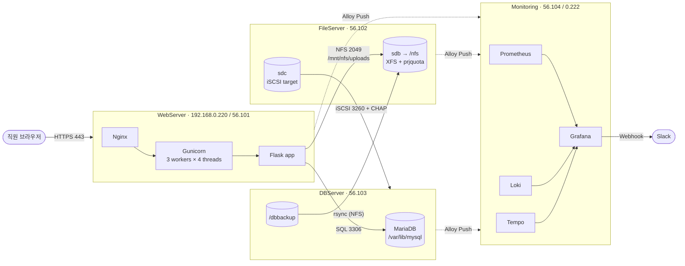

# filehub — JYIT 사내 공용 파일서버 구축 · 통합 관제

> 부서마다 흩어져 있던 파일을 **웹에서 로그인해 팀 폴더로 주고받는 사내 공유 드라이브**로 모으고,  
> 서버 4대의 **M·E·L·T(메트릭 · 이벤트 · 로그 · 트레이스)** 를 한곳에서 관제해 이상 징후를 Slack으로 알리는 프로젝트입니다.

<p>
  
  
  
  
  
  
  
  
</p>

더존비즈온 Cloud DX Academy 클라우드 엔지니어 부트캠프 · **1팀 (File Server & Monitoring)**

---

## 목차

1. [주요 기능](#주요-기능)
2. [아키텍처](#아키텍처)
3. [서버 구성](#서버-구성)
4. [기술 스택](#기술-스택)
5. [저장소 설계 (NFS · iSCSI)](#저장소-설계-nfs--iscsi)
6. [웹 앱 (filehub)](#웹-앱-filehub)
7. [관제 (Grafana LGTM + Alloy)](#관제-grafana-lgtm--alloy)
8. [장애 시나리오와 대응](#장애-시나리오와-대응)
9. [디렉터리 구조](#디렉터리-구조)
10. [설치 순서](#설치-순서)
11. [트러블슈팅 요약](#트러블슈팅-요약)
12. [보안 메모](#보안-메모)

---

## 주요 기능

**파일 공유 웹**
- 회원가입(팀 선택 · 관리자 승인) → 로그인 → 팀 폴더 / 공용 폴더에 업로드 · 다운로드 · 교체 · 삭제
- 팀 단위 접근 제어 — 다른 팀 폴더는 조회 · 다운로드 차단
- 하위 폴더 생성(DB에서만 관리), 정렬(이름 · 최신 · 크기 · 올린 사람)
- **폴더 용량 한도 이중 방어** : 앱(DB `folders.quota_mb`) → 413 / 파일서버 XFS 프로젝트 쿼터 → 507
- **5회 연속 로그인 실패 시 계정 자동 잠금**, 30분 미사용 · 8시간 경과 시 자동 로그아웃
- CSRF 토큰, HttpOnly · Secure 쿠키, 업로드는 `.part` 임시 파일 → 원자적 rename
- 모든 주요 동작을 **JSON 감사 로그**(`filehub.audit`)로 남김 — `trace_id` 포함

**스토리지**
- NFS : 파일서버 sdb → `/nfs` → 웹 업로드 저장소 · DB 백업 사본
- iSCSI : 파일서버 sdc → DB 서버 LVM(`vg_db`) → MariaDB 데이터 · 덤프 원본
- **LVM 무중단 자동 증설** (85% 2회 연속 → +3G)

**관제**
- 서버 4대 Alloy가 메트릭 · 로그 · 트레이스를 Push
- 통합 대시보드 `JYIT 통합 관제 M·E·L·T`
- Slack 경보 (디스크 80%, 로그인 실패 급증, 업로드 차단, 자동 증설 조치/불가)

---

## 아키텍처



**요청 흐름** : 직원 → WebServer(HTTPS 443) → FileServer(NFS 2049) · DBServer(SQL 3306)  
**스토리지 흐름** : DBServer → FileServer(iSCSI 3260)  
**관제 흐름** : 서버 4대 → Monitoring (Alloy Push)

---

## 서버 구성

VirtualBox VM 4대, Rocky Linux 10.1

| 서버 | 호스트명 | 역할 | 서버망 (enp0s8, work 존) | 사용자망 (enp0s10) |
|---|---|---|---|---|
| 웹 | `WebServer` | Nginx → Gunicorn → Flask | 192.168.56.101 | 192.168.0.220 |
| 파일 | `FileServer` | NFS(sdb1 → /nfs), iSCSI 타깃(sdc) | 192.168.56.102 | — |
| DB | `DBServer` | MariaDB, iSCSI 디스크 위 LVM | 192.168.56.103 | — |
| 관제 | `Monitoring` | Prometheus · Loki · Tempo · Grafana · Alloy | 192.168.56.104 | 192.168.0.222 |

- 서버 간 연동은 **호스트 전용망 192.168.56.x** 로 통일, 인터넷은 NAT(enp0s3)
- 브리지가 있는 서버는 `ipv4.never-default` 로 default 경로를 하나만 유지 (비대칭 라우팅 방지)
- 방화벽은 끄지 않고 **rich rule로 출발지 IP까지 묶어서** 필요한 포트만 허용

| 포트 | 서비스 | 허용 대상 |
|---|---|---|
| 443 / 80 | Nginx | 사용자망 (dmz 존) |
| 2049 · 111 · 20048 | NFS | 56.101, 56.103 |
| 3260 | iSCSI | 56.103 |
| 3306 | MariaDB | 56.101(앱), 56.104(Grafana 조회) |
| 9090 · 3100 · 4317 | Prometheus · Loki · Tempo | work 존 (Alloy Push) |
| 3000 | Grafana (HTTPS) | 사용자망 |

---

## 기술 스택

| 영역 | 사용 기술 |
|---|---|
| OS / 가상화 | Rocky Linux 10.1, VirtualBox |
| 웹 / WAS | Nginx (TLS 1.2/1.3, JSON 접근 로그), Gunicorn (gthread), Flask 3, PyMySQL |
| 인증서 | 사설 CA `filehub Root CA` → 웹 · Grafana 인증서 서명 (SAN에 IP 지정) |
| 스토리지 | NFS v4, iSCSI (targetcli / iscsiadm, CHAP), LVM, XFS 프로젝트 쿼터 |
| DB | MariaDB (utf8mb4), mysqldump + rsync 백업 |
| 관제 | Grafana 13.2.4, Prometheus 3.15, Loki 3.7, Tempo 3.1, Grafana Alloy 1.20 |
| 트레이스 | OpenTelemetry (`opentelemetry-instrument`, 업로드 단계별 수동 span) |
| 알림 | Grafana Alerting → Slack Incoming Webhook (커스텀 템플릿 `jyit`) |

---

## 저장소 설계 (NFS · iSCSI)

| | NFS (폴더 공유) | iSCSI (디스크 공유) |
|---|---|---|
| 파일서버 디스크 | sdb → sdb1 → XFS → `/nfs` | sdc (포맷하지 않음) |
| 파일시스템 주인 | 파일서버 | **DB 서버** (LVM · XFS를 직접 만듦) |
| 쓰는 곳 | 웹 업로드, DB 백업 사본 | MariaDB 데이터, 덤프 원본 |
| 확장 | 일반 파티션 → 증설 불가 | LVM → 무중단 증설 가능 |

### NFS

```
FileServer /nfs
├─ share/  → WebServer:/mnt/nfs
│   ├─ uploads/{general,team1,team2,team4,team5,team6}/<UUID>   ← XFS 프로젝트 쿼터 (팀 500M, 공용 2G)
│   └─ .loadtest/
└─ backup/db/  → DBServer:/mnt/nfs   ← mysqldump 사본
```

- 서비스 계정 `filehub` **UID/GID 2000** 을 웹서버 · 파일서버에 동일하게 (NFS는 숫자로 권한 판단)
- `root_squash` 유지 → 백업 폴더는 `nobody` 소유
- 웹서버 fstab : `_netdev,x-systemd.automount,nofail` + 앱 서비스에 `RequiresMountsFor=/mnt/nfs`

### iSCSI + LVM

```
FileServer sdc ─ backstore block/lun0 (by-id 경로)
   └ target iqn.2026-10.com.cloud:fileserver ─ ACL iqn.2026-10.com.cloud:db + CHAP
        ═══ 3260 ═══▶ DBServer (by-path 디스크)
                         └ PV → VG vg_db (100G)
                              ├ lv_db      40G → /var/lib/mysql
                              ├ lv_backup  30G → /dbbackup
                              └ 여유 30G (자동 증설용)
```

- 디스크 이름(sdb/sdc)은 바뀔 수 있으므로 **by-id · by-path · IQN** 으로 지정
- 파일서버 `lvm.conf` 의 `global_filter` 로 sdc 제외 → 두 서버가 같은 VG를 동시에 활성화하는 사고 방지
- MariaDB drop-in `RequiresMountsFor=/var/lib/mysql` → iSCSI 디스크 없이 빈 DB로 뜨는 것 방지

### 자동 증설 (`lv_autoextend.sh` + systemd timer 15초)

- 사용률 **85% 이상이 2회 연속**이면 `lvextend -r -L +3G` (XFS 동시 확장, 서비스 무중단)
- LV별 상한(`lv_db` 55G, `lv_backup` 45G) 초과 또는 VG 여유 5G 미만이면 증설하지 않고 *수동 조치 필요* 경고
- 결과는 syslog 태그 `storage-load` → Loki → Grafana 경보 → Slack

### 백업

```
mysqldump → /dbbackup (iSCSI, sdc) → rsync → /mnt/nfs (NFS, sdb)
```
매일 03:00 cron, 7일 보관. 원본 DB와 덤프 사본이 **서로 다른 디스크**에 남습니다.  
복원 연습은 `filehub_restore` 임시 DB에 풀어 확인 후 필요한 테이블만 옮깁니다.

---

## 웹 앱 (filehub)

```
브라우저 ─HTTPS─▶ Nginx(:443) ─▶ Gunicorn(127.0.0.1:8000) ─▶ Flask app.py
                                                            ├─ 파일 본문 → /mnt/nfs/uploads/<팀>/<UUID>
                                                            ├─ 메타데이터 → MariaDB (filehub_app 계정)
                                                            ├─ 감사 로그 → journald → Alloy → Loki
                                                            └─ 트레이스 → Alloy(127.0.0.1:4317) → Tempo
```

### 주요 라우트

| 경로 | 설명 |
|---|---|
| `GET /` · `POST /login` · `POST /logout` | 로그인 / 로그아웃 |
| `GET, POST /signup` | 회원가입 (팀 선택, 관리자 승인 대기) |
| `GET /files` | 파일 · 폴더 목록 |
| `POST /upload` | 업로드 (JS가 파일을 하나씩 전송) |
| `GET /download/<id>` | 다운로드 |
| `POST /files/<id>/replace` · `/delete` | 파일 교체 · 소프트 삭제 |
| `POST /folders` · `/folders/<id>/delete` | 하위 폴더 생성 · 삭제 |
| `GET, POST /admin/users` | 관리자 — 사용자 승인 · 팀 변경 · 잠금 해제 |
| `GET /health` | DB 접속 + NFS 쓰기 점검 (로그인 불필요, 실패 시 503) |

### 업로드 처리와 트레이스 구간

```
quota.check  →  nfs.save  →  db.insert
(DB 한도 확인)   (.part 저장 → rename)   (files INSERT, 실패 시 파일 삭제)
```

| 결과 | 응답 | 감사 로그 |
|---|---|---|
| 폴더 한도(`quota_mb`) 초과 | 413 "폴더 용량 한도" | `UPLOAD FAIL` 용량 한도 초과 |
| 파일서버 XFS 쿼터 초과 (`EDQUOT`/`ENOSPC`) | 507 "디스크 한도 가득 참" | `UPLOAD FAIL` 디스크 쿼터 초과 |
| 정상 | 200 | `UPLOAD SUCCESS` |

### DB 스키마

| 테이블 | 핵심 칸 |
|---|---|
| `users` | username, email, password_hash, role(admin/staff), team, failed_count, is_locked |
| `folders` | name, parent_id(NULL=팀 폴더), dept, **quota_mb** |
| `files` | original_name, stored_name(`팀/UUID`), size_bytes, folder_id, is_deleted(소프트 삭제) |

DB 계정은 용도별로 분리 — `filehub_app@56.101`(CRUD), `filehub_grafana@56.104`(조회 전용, `password_hash` 칸 제외)

### 설정 (`/opt/filehub/.env`, 권한 600)

```ini
DB_HOST=192.168.56.103
DB_PORT=3306
DB_USER=filehub_app
DB_PASS=<filehub_app 비밀번호>
DB_NAME=filehub
SECRET_KEY=<python3 -c "import secrets; print(secrets.token_hex(32))">
NFS_DIR=/mnt/nfs/uploads
MAX_UPLOAD_MB=2048          # Nginx client_max_body_size 와 맞춤
SESSION_COOKIE_SECURE=1     # HTTPS 적용 후
LOCK_THRESHOLD=5
```

### 관리 명령 (`manage.py`)

```bash
cd /opt/filehub/app
sudo -u filehub /opt/filehub/.venv/bin/python manage.py check                         # 설치 점검
sudo -u filehub /opt/filehub/.venv/bin/python manage.py create-user admin "관리자" admin
sudo -u filehub /opt/filehub/.venv/bin/python manage.py list-users
sudo -u filehub /opt/filehub/.venv/bin/python manage.py passwd <아이디>
sudo -u filehub /opt/filehub/.venv/bin/python manage.py unlock <아이디>
```

---

## 관제 (Grafana LGTM + Alloy)

| 신호 | 수집 | 저장 | 내용 |
|---|---|---|---|
| **M**etrics | Alloy `prometheus.exporter.unix` (15s) | Prometheus | CPU · 메모리 · 디스크 · I/O |
| **E**vents | Flask 감사 로그 (JSON) | Loki | LOGIN · UPLOAD · ACCOUNT_LOCKED … |
| **L**ogs | messages · secure · Nginx JSON · mariadb.log | Loki | 서버별 `hostname` 라벨 |
| **T**races | OpenTelemetry → Alloy OTLP | Tempo | 서비스 `filehub-web`, 업로드 단계별 span |

- Prometheus는 `--web.enable-remote-write-receiver` 로 Push 수신
- 관제 서버 자신도 Alloy로 Self-Monitoring (127.0.0.1)
- Grafana MySQL 데이터소스로 filehub DB 조회 (조회 전용 계정)

### 경보 규칙 → Slack

| 경보 | 데이터 | 조건 |
|---|---|---|
| 디스크 사용률 80% 초과 | Prometheus | NFS(`/dev/sdb1`) · DB LVM(`vg_db-*`) · OS 디스크로 대상 제한 |
| iSCSI 자동 증설 조치 / 불가 | Loki | `storage-load` 로그의 `action=auto_extend` / `auto_extend_skipped` |
| 폴더 용량 초과 업로드 차단 | Loki | 사용자별 5분간 `UPLOAD FAIL` ≥ 1 |
| 웹 로그인 실패 급증 | Loki | 같은 IP 5분간 `LOGIN FAIL` ≥ 4 |

```logql
# 웹 로그인 실패 (감사 로그 형식이 바뀌어도 줄 안의 {...} JSON을 꺼내 읽음)
sum by (ip) (count_over_time({job="syslog", hostname="WebServer"} |= "filehub.audit"
  | regexp `(?P<audit>\{.*\})` | line_format "{{.audit}}" | json
  | action="LOGIN" | result="FAIL" [5m]))
```

```traceql
# 느린 업로드 찾기
{ resource.service.name = "filehub-web" && duration > 2s }
```

Slack 메시지는 커스텀 템플릿 `jyit` 으로 **발생/해제 · 대상 · 내용 · 발생 시각 · 대시보드 링크**만 정리해 보냅니다.

---

## 장애 시나리오와 대응

모든 시나리오는 **상황 → 감지 → 원인 분석 → 조치** 순서로 검증했습니다.

| # | 상황 | 감지 | 원인 분석 | 조치 |
|---|---|---|---|---|
| ① | DB 백업 공간(iSCSI `/dbbackup`) 86%까지 채움 | Slack *디스크 사용률 80% 초과* | 저장소 사용률 패널, 파일서버 sdc 쓰기 상승 | 85% 2회 연속 → `lv_backup` **+3G 무중단 자동 증설** → Slack *자동 증설 조치* |
| ② | 웹 → 파일서버 NFS 구간을 `tc netem 2mbit` 로 제한, 업로드가 99%에서 멈춤 | 경보 없음(사용자 신고), Tempo *느린 요청* 패널 | 트레이스 폭포에서 `nfs.save` 만 긺 → NFS 구간 병목 | 제한 해제 후 재업로드 정상 |
| ③ | 600MB 파일을 팀 폴더(한도 500MB)에 업로드 *(참여형)* | 앱이 413으로 차단 → Slack *업로드 차단* | 감사 로그 `UPLOAD FAIL` 의 사용자 · 이메일 · IP | 이메일로 당사자 연락, 필요 시 앱 한도 + XFS 쿼터 함께 상향 |
| ④ | 팀 계정 비밀번호 반복 실패 *(참여형)* | Slack *웹 로그인 실패 급증* (IP별) | Loki `LOGIN FAIL` 계정 · IP | 5회 연속 실패 시 자동 잠금 → 본인 확인 후 `manage.py unlock` |
| ⑤ | *(선택)* NFS `/nfs` 86%까지 채움 | Slack *디스크 사용률 80% 초과* | 파일서버 sdb 쓰기 상승 | 일반 파티션이라 증설 불가 → 파일 정리 (①과 대비) |

<details>
<summary>시나리오 ② 재현 명령 (WebServer)</summary>

```bash
# 파일서버(56.102)로 가는 패킷만 2mbit 로 제한
tc qdisc add dev enp0s8 root handle 1: prio bands 4
tc qdisc add dev enp0s8 parent 1:4 handle 40: netem rate 2mbit
tc filter add dev enp0s8 parent 1: protocol ip prio 1 u32 match ip dst 192.168.56.102/32 flowid 1:4

# 해제 (반드시)
tc qdisc del dev enp0s8 root
```
</details>

---

## 디렉터리 구조

```
.
├── README.md
├── app/                      # Flask 웹 앱 → 웹서버 /opt/filehub/app
│   ├── app.py                # 라우트 전체 (로그인, 업로드, 폴더, 관리자, /health)
│   ├── config.py             # 환경변수에서 설정 읽기
│   ├── db.py                 # 요청마다 MariaDB 연결 1개
│   ├── manage.py             # 관리 CLI (계정 생성 · 잠금 해제 · 점검)
│   ├── requirements.txt      # Flask, gunicorn, PyMySQL
│   ├── templates/            # login · signup · files · admin_users · error ...
│   └── static/               # css · js · img (Nginx가 직접 서빙)
├── scripts/
│   ├── lv_autoextend.sh      # iSCSI LV 자동 증설 (DBServer, systemd timer)
│   └── storage_load.sh       # 시연용 디스크 · I/O 부하 생성
└── docs/
    └── 1팀_워크북.pdf         # 서버별 구축 · 관제 · 시연 통합 워크북
```

---

## 설치 순서

파트끼리 서로 필요한 것이 있어 아래 순서로 진행합니다. (명령은 모두 root)

| 단계 | 할 일 | 이유 |
|---|---|---|
| 1 | 4대 호스트 이름 · 고정 IP · 방화벽 존 | 모든 연결과 관제 라벨의 기준 |
| 2 | 파일서버 NFS(sdb, XFS 쿼터), 웹서버 마운트 | 웹 업로드 저장소 |
| 3 | iSCSI 타깃 → DB서버 로그인 · LVM · `/dbbackup` | DB 디스크 준비 |
| 4 | MariaDB 설치 · 스키마 · 계정 · 3306 방화벽 | DB 데이터 생성 |
| 5 | DB 데이터를 iSCSI LV로 이동, 자동 증설 타이머 | 4단계 MariaDB 필요 |
| 6 | DB 백업 NFS 마운트 · cron · 복원 연습 | `/dbbackup` 과 filehub DB 필요 |
| 7 | 웹/WAS (venv, `.env`, systemd, 사설 CA, Nginx, SELinux, OTel) | NFS · DB 계정 필요 |
| 8 | 관제 (Prometheus · Loki · Tempo · Grafana, Alloy 4대) | 수집 대상 필요 |

<details>
<summary>웹 앱 빠른 배치 (WebServer)</summary>

```bash
dnf install -y nginx python3 python3-pip mariadb policycoreutils-python-utils

mkdir -p /opt/filehub && cp -r app /opt/filehub/
python3 -m venv /opt/filehub/.venv
/opt/filehub/.venv/bin/pip install -r /opt/filehub/app/requirements.txt

vi /opt/filehub/.env && chmod 600 /opt/filehub/.env     # 위 설정 참고
chown -R filehub:filehub /opt/filehub

sudo -u filehub /opt/filehub/.venv/bin/python /opt/filehub/app/manage.py check

systemctl enable --now filehub nginx
curl -k https://127.0.0.1/health    # {"db":true,"ok":true,"storage":{"nfs":true}}
```

`filehub.service` 핵심 :
```ini
[Unit]
After=network-online.target remote-fs.target
RequiresMountsFor=/mnt/nfs

[Service]
User=filehub
EnvironmentFile=/opt/filehub/.env
ExecStart=/opt/filehub/.venv/bin/gunicorn --worker-class gthread --workers 3 --threads 4 \
          --bind 127.0.0.1:8000 --timeout 120 --access-logfile - app:app
```
</details>

**서버 기동 순서** : FileServer → DBServer → WebServer → Monitoring  
(파일서버가 먼저 떠야 iSCSI · NFS 의존 서비스가 정상 기동)

---

## 트러블슈팅 요약

| 증상 | 원인 | 해결 |
|---|---|---|
| Grafana 데이터소스 *Missing signature* | SELinux가 플러그인 소켓(`/run/grafana`) 생성 차단 | `grafana-selinux` 제거, 관제 서버만 permissive |
| `nc` 가 *No route to host* | enp0s8은 work 존인데 포트를 public에만 개방 | work 존에 9090 · 3100 · 4317 개방 |
| Tempo 설정 미반영 | `enable --now` 는 실행 중 서비스를 재시작하지 않음 | 설정 변경 후 `systemctl restart` |
| 디스크 경보 15개 동시 Firing | 임계치 0, 감시 대상 미제한 | 임계치 80, `device` 정규식으로 제한 |
| Slack에 *DatasourceNoData* | 사건이 없으면 Loki가 빈 결과 반환 | No data 처리 → Normal |
| 로그인 경보가 조용히 0건 | OTel 적용으로 감사 로그 앞에 `[trace_id=…]` 추가 | 줄 안의 `{...}` JSON을 꺼내는 regexp로 변경 |
| Nginx 로그 미수집 | 사이트 전용 로그 `filehub_access.log`(JSON) 사용 | Alloy 경로 · 쿼리를 `json` 방식으로 |
| 업로드 "저장소에 쓰지 못했습니다" | 웹 · 파일서버 filehub UID 불일치 | 양쪽 UID 2000 확인 |
| 재부팅 후 iSCSI 타깃 소실 | `targetcli saveconfig` 누락 / target.service 비활성 | 재생성 후 saveconfig, `enable --now target` |
| 502 Bad Gateway | Gunicorn 중단 또는 SELinux | `httpd_can_network_connect` on |

---

## 보안 메모

- 비밀 값(DB 비밀번호, `SECRET_KEY`, CHAP 비밀번호, Slack Webhook URL)은 **저장소에 올리지 않습니다.** `.env` 는 `.gitignore` 대상
- 공인 도메인이 없어 사설 CA를 사용 — PC에 `ca.crt` 하나만 신뢰 등록하면 웹 · Grafana 모두 경고 없이 접속
- 파일서버 · DB · 관제 SSH는 웹서버(56.101)를 거쳐서만 접속, DB 원격 root 제거
- 관제 서버의 SELinux permissive는 실습 환경 절충안 — 운영이라면 Grafana용 정책을 별도로 작성
- 시연용 경보 속도(평가 10s, Group wait 5s)는 발표 후 운영값(평가 1m, Pending 1m)으로 복구

---

<sub>Cloud DX Academy 8기 · 1팀 · 2026</sub>
